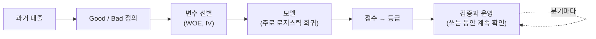

# 금융 리스크 모델 검증 뜯어보기

> 직접 구현하는 스코어카드 **성능(AUC · GINI · K-S)** 및 **안정성(PSI)** 지표

| | |
|---|---|
| **주최** | 빅데이터 분석 학회 BDAI (Big Data Artificial Intelligence) |
| **강사** | 조은정 (외국계 금융사 Data Analyst) |
| **일시** | 2026-11-16 (월) 19:30 ~ 21:30 |
| **방식** | Zoom 실시간 온라인 원데이클래스 |
| **내용** | 신용평가 모델 개발·검증 과정, AUC·GINI·K-S·PSI 이해 및 Python 직접 구현 실습 |

## 목차

- [1부. 개념](#1부-개념)
  - [CSS란?](#css-credit-scoring-system란)
  - [왜 검증을 반복하나](#왜-검증을-반복하나)
  - [검증이 묻는 두 가지](#검증이-묻는-두-가지)
  - [Good / Bad 정의](#good--bad-정의)
  - [예제 데이터](#예제-데이터)
  - [지표 설명](#지표-설명)
- [2부. Hands-On](#2부-hands-on)
  - [왜 직접 구현하나](#왜-직접-구현하나)
  - [분기 검증 순서](#분기-검증-순서)
  - [Excel](#excel)
  - [Python](#python)
  - [실습 1](#실습-1-등급은-해가-바뀌어도-맞을까-15분)
  - [실습 2](#실습-2-세-줄-의견-10분)
  - [자주 틀리는 네 곳](#자주-틀리는-네-곳)
- [요약](#요약)
- [더 읽을거리](#더-읽을거리)

---

## 1부. 개념

### CSS (Credit Scoring System)란?

돈을 빌려줘도 될지 **점수로 알려 주는 시스템**임. 사람의 감을 점수로 바꾼 것이라 빠르고, 누구에게나 같은 기준을 적용함. 두 가지 일을 함.

| 종류 | 질문 | 쓰임 |
|---|---|---|
| **ASS** (신청 심사) | 처음 온 손님을 받아도 될까? | 승인 여부, 한도, 금리 |
| **BSS** (행동 평점) | 빌려 간 손님이 계속 잘 갚을까? | 한도 조정, 연장, 조기 경보 |

### 왜 검증을 반복하나

신용평가 모델은 **과거 고객을 보고 그린 지도**임. 지도가 그려진 뒤에도 세상은 바뀌므로, 정해진 주기(보통 분기)마다 아직 믿어도 되는지 다시 시험함.



### 검증이 묻는 두 가지

| 구분 | 질문 | 지표 |
|---|---|---|
| **성능** | 아직 잘 구분하는가 | AUC, GINI, K-S |
| **안정성** | 들어오는 고객이 바뀌었는가 | PSI |

둘은 서로를 대신하지 못하므로 **항상 둘 다** 봄.

### Good / Bad 정의

정해진 관찰 기간 안에 일정 일수 이상 연체하면 부도(Bad), 아니면 정상(Good)임.

> [!IMPORTANT]
> 기준을 바꾸면 부도 건수가 달라지고 AUC, K-S도 달라짐. 지표를 볼 때는 **부도의 정의부터 확인**함.

### 예제 데이터

| 등급 | 전체 | 부도 (Bad) | 정상 (Good) | 부도율 |
|:---:|---:|---:|---:|---:|
| A | 1,700 | 95 | 1,605 | 5.6% |
| B | 2,900 | 360 | 2,540 | 12.4% |
| C | 2,800 | 590 | 2,210 | 21.1% |
| D | 1,500 | 430 | 1,070 | 28.7% |
| E | 750 | 275 | 475 | 36.7% |
| F | 270 | 115 | 155 | 42.6% |
| G | 80 | 38 | 42 | 47.5% |
| **합계** | **10,000** | **1,903** | **8,097** | **19.0%** |

### 지표 설명

#### AUC

ROC AUC는 **줄 세우기 시험**임. 못 갚을 사람을 줄 뒤쪽에 잘 세웠는지를 숫자 하나로 알려 줌.

**두 명 뽑기 게임**: Bad 1명, Good 1명을 아무나 뽑았을 때 Bad가 더 위험한 쪽에 있으면 모델이 이김.

| 결과 | 점수 |
|---|:---:|
| 이김 | 1 |
| 비김 (같은 등급) | 0.5 |
| 짐 | 0 |

모든 쌍을 비교한 승률이 곧 AUC임.

**사람이 많으면 넓이로 구함.**

1. 위험한 등급(G)부터 한 칸씩 열면서 (누적 Good, 누적 Bad)를 점으로 찍어 곡선을 그림.
2. 곡선 아래를 등급 경계마다 세로로 자르면 **사다리꼴 7조각**이 됨.
3. 일곱 조각의 넓이를 모두 더하면 AUC임.

$$
\text{사다리꼴 넓이} = \text{가로 폭} \times \frac{\text{왼쪽 높이} + \text{오른쪽 높이}}{2}
$$

예) C등급: $0.273 \times \dfrac{0.451 + 0.761}{2} = 0.1654$

#### GINI

눈금만 바꾼 AUC임. 찍기 모델이 0, 완벽한 모델이 1이 되도록 다시 매김.

$$
\text{GINI} = 2 \times \text{AUC} - 1
$$

AUC는 아무것도 안 해도 0.5가 나오지만, GINI는 **찍기보다 얼마나 나은지**만 남김. 예) 0.36이면 완벽까지 거리의 36%를 왔다는 뜻임.

#### K-S

누적 Bad와 누적 Good의 차이가 **가장 크게 벌어진 지점**임. AUC가 줄 전체의 평균 실력이라면, K-S는 가장 잘하는 한 지점의 실력임.

$$
\text{K-S} = \max \left| \text{누적 Bad 비중} - \text{누적 Good 비중} \right|
$$

#### PSI

손님 **구성의 변화**를 보는 지표임. 등급마다 구해 전부 더함.

$$
\text{PSI} = \sum_i (\text{최근 비중}_i - \text{기준 비중}_i) \times \ln\frac{\text{최근 비중}_i}{\text{기준 비중}_i}
$$

- 두 분포가 같으면 0, 달라질수록 커지며 음수는 나오지 않음.
- **부도 여부를 몰라도** 계산할 수 있음.

#### 숫자를 읽는 기준

PSI는 관행적으로 아래 구간으로 해석함.

| PSI | 해석 |
|---|---|
| 0.1 미만 | 안정 |
| 0.1 ~ 0.25 | 주의 |
| 0.25 초과 | 큰 변화 |

> [!NOTE]
> 기준은 법칙이 아니라 **관행**임. 숫자 하나로 가르기보다 지난 분기보다 얼마나 움직였는지를 함께 봄. 지표는 넷이지만 묻는 것은 둘임. *잘 구분하는가, 손님이 바뀌었는가.*

---

## 2부. Hands-On

실제 대출 데이터로 직접 검증해 봄.

### 왜 직접 구현하나

라이브러리가 있어도 실무에서는 직접 구현할 일이 생각보다 자주 있음.

- Python을 못 쓰는 환경
- 집계표만 받을 때
- 정의가 라이브러리 기본값과 다를 때
- 독립 검증과 감사 대응
- 라이브러리에 없는 지표
- 패키지 설치가 막힌 내부망

> **원칙**: 계산은 직접 구현하고, 라이브러리는 그 결과를 **검산**하는 용도로 씀.

### 분기 검증 순서

1. **표본 정하기**
2. **Good/Bad 붙이기**: 결과가 확인된 대출에만
3. **등급별로 세기**: 피벗 테이블 한 번
4. **지표 계산**: AUC, GINI, K-S, PSI
5. **판정과 의견**: 계속 써도 되는지 기록

### Excel

#### (1) 등급별 건수표

| 순서 | 등급 | 부도 (Bad) | 정상 (Good) | 합계 |
|:---:|:---:|---:|---:|---:|
| 1 | G | 38 | 42 | 80 |
| 2 | F | 115 | 155 | 270 |
| 3 | E | 275 | 475 | 750 |
| 4 | D | 430 | 1,070 | 1,500 |
| 5 | C | 590 | 2,210 | 2,800 |
| 6 | B | 360 | 2,540 | 2,900 |
| 7 | A | 95 | 1,605 | 1,700 |

1. 원본에서 피벗 테이블을 만듦. 행은 등급, 열은 Good/Bad, 값은 건수임.
2. 등급을 **위험한 쪽(G)부터** 정렬함.
3. 건수를 노란 칸에 붙여 넣음. (워크북 2. 성능 검증 시트, 부도와 정상 두 열만 사람이 입력)
4. 누적 Bad와 누적 Good의 마지막 줄이 100%인지 확인함.

> [!TIP]
> 표 첫 줄에 `(시작점)` 행을 두고 누적값을 0으로 두면 모든 줄에 같은 수식을 쓸 수 있음.

#### (2) 성능 지표 수식

G등급이 7행, 합계가 14행일 때의 수식임. 한 줄을 채우고 아래로 끌어 내림.

| 열 | 수식 (7행) | 뜻 |
|---|---|---|
| F Bad 비중 | `=B7/B$14` | 이 등급의 부도가 전체 부도에서 차지하는 몫 |
| G Good 비중 | `=C7/C$14` | 이 등급의 정상이 전체 정상에서 차지하는 몫 |
| H 누적 Bad | `=H6+F7` | 윗줄 누적값에 이번 등급을 더함 |
| I 누적 Good | `=I6+G7` | 같은 방식 |
| J 누적 차이 | `=H7-I7` | K-S 후보 |
| K 사다리꼴 | `=(I7-I6)*(H7+H6)/2` | 가로 폭 × 평균 높이 |

```text
AUC  = SUM(K7:K13)
GINI = 2*AUC - 1
K-S  = MAX(J7:J13)
```

#### (3) PSI 수식

5행 기준임.

| 열 | 수식 (5행) | 뜻 |
|---|---|---|
| D 기준 비중 | `=B5/B$12` | 기준 연도에 이 등급이 차지한 몫 |
| E 최근 비중 | `=C5/C$12` | 최근 연도에 이 등급이 차지한 몫 |
| F 차이 | `=E5-D5` | 늘었으면 양수, 줄었으면 음수 |
| G 로그 비 | `=LN(E5/D5)` | 늘었으면 양수, 줄었으면 음수 |
| H 기여분 | `=F5*G5` | 부호가 같으니 항상 0 이상 |

```text
PSI = SUM(H5:H11)
```

> [!WARNING]
> 건수가 0인 등급이 있으면 `LN`을 계산할 수 없음. 옆 등급과 합치고(예: F와 G), 합쳤다고 보고서에 적어 둠.

### Python

#### 엑셀과 짝짓기

| Excel | Python |
|---|---|
| 피벗 테이블 | `groupby` |
| 위에서부터 누적 | `cumsum()` |
| `SUM` | `.sum()` |
| `MAX` | `.max()` |
| `LN` | `np.log()` |

> [!TIP]
> `bad` 열은 못 갚았으면 1, 잘 갚았으면 0임. 등급별로 더하면 부도 건수, 세면 전체 건수가 됨.

#### 등급표 · 성능 지표 · PSI

```python
import numpy as np
import pandas as pd


def grade_table(df):
    tab = df.groupby('grade')['bad'].agg(bad='sum', n='count')
    tab['good'] = tab['n'] - tab['bad']
    # riskiest grade (G) first
    return tab.sort_index(ascending=False)


def perf(tab):
    # Excel columns H, I: cumulative bad and good
    cb = (tab['bad']  / tab['bad'].sum()).cumsum().to_numpy()
    cg = (tab['good'] / tab['good'].sum()).cumsum().to_numpy()

    # MAX of Excel column J
    ks = (cb - cg).max()

    # the (start) row in Excel: prepend 0
    x = np.r_[0, cg]
    y = np.r_[0, cb]

    # SUM of Excel column K: width x average height
    auc = ((x[1:] - x[:-1]) * (y[1:] + y[:-1]) / 2).sum()

    return auc, 2 * auc - 1, ks


def psi(base_n, recent_n):
    a = base_n / base_n.sum()      # base share
    b = recent_n / recent_n.sum()  # recent share
    return ((b - a) * np.log(b / a)).sum()
```

- `x[1:] - x[:-1]`: 이번 줄에서 윗줄을 뺀 값 (엑셀의 `I7 - I6`)
- `y[1:] + y[:-1]`: 이번 줄과 윗줄의 합 (엑셀의 `H7 + H6`)
- 예제 표를 넣으면 **AUC 0.6816, GINI 0.3633, K-S 0.2728**이 나옴.

#### 라이브러리 대조

```python
from sklearn.metrics import roc_auc_score
from scipy.stats import ks_2samp

# grade to number: A=0 ... G=6 (higher = riskier)
risk = dict(zip('ABCDEFG', range(7)))
score = df['grade'].map(risk)

roc_auc_score(df['bad'], score)        # vs my auc
ks_2samp(score[df['bad'] == 1],
         score[df['bad'] == 0]).statistic  # vs my ks
```

> [!NOTE]
> scikit-learn에는 PSI 함수가 없으므로 엑셀 PSI 시트의 값과 대조함.

> [!CAUTION]
> 소수 넷째 자리까지 같아야 정상임. AUC가 `1 - 정답`으로 나오면 등급 순서가 거꾸로임.

### 실습 1: 등급은 해가 바뀌어도 맞을까 (15분)

Kaggle에 공개된 Lending Club 데이터의 추출본을 사용함. (Kaggle 계정 불필요)

| 쓰는 열 | 내용 |
|---|---|
| `issue_d` | 대출 실행 시점. 연도로 표본을 나눔 |
| `grade` | 대출사가 매긴 등급 A – G |
| `loan_status` | 상환 결과. `bad` 열의 재료임 |

**할 일**

- [ ] `loan_status`로 `bad` 열 만들기
- [ ] 실행 연도로 기준 연도와 최근 연도 나누기
- [ ] `grade_table`로 두 해의 등급표 만들기
- [ ] `perf`, `psi`로 AUC, GINI, K-S, PSI 계산하기
- [ ] `roc_auc_score`와 값 대조하기

두 해의 등급별 건수를 엑셀 성능 검증 시트의 노란 칸에 붙여 넣었을 때 같은 숫자가 나오면 성공임.

#### 끝나지 않은 대출은 뺌

| `loan_status` 값 | 처리 | 이유 |
|---|---|---|
| Charged Off, Default | `bad = 1` | 못 갚은 것으로 확정 |
| Fully Paid | `bad = 0` | 다 갚음 |
| Current | 제외 | 아직 갚는 중 |
| Late, In Grace Period | 제외 | 결과가 정해지지 않음 |

```python
done = df['loan_status'].isin(
    ['Fully Paid', 'Charged Off', 'Default'])
df = df[done].copy()
df['bad'] = (df['loan_status'] != 'Fully Paid').astype(int)
```

> [!WARNING]
> **최근 연도일수록 주의.** 만기가 3년, 5년인 대출이라 최근에 나간 것일수록 아직 끝나지 않은 건이 많음. 끝난 건만 남기면 일찍 부도난 대출이 상대적으로 많이 남아 부도율이 높게 보일 수 있음. 실무에서는 관찰 기간(예: 실행 후 12개월)을 똑같이 맞춰 비교함.

### 실습 2: 세 줄 의견 (10분)

> "이 모델, 계속 써도 될까요? 숫자는 근거이고, 산출물은 판단입니다."

| 줄 | 담을 것 | 예시 (앞의 예제 숫자) |
|---|---|---|
| 성능 | 아직 잘 구분하는가. 근거 숫자와 변화 폭 | 최근 AUC 0.625. 기준 연도 0.682보다 0.056 낮고 내부 기준 0.68에 미달함. |
| 안정성 | 고객 구성이 바뀌었는가. 어느 쪽으로 | PSI 0.105로 주의 구간. A, B가 줄고 D, E가 늘어 위험한 쪽으로 이동함. |
| 결론 | 계속 사용 / 조건부 사용 / 재개발 검토 중 하나와 다음 할 일 | 조건부 사용. 등급별 부도율 순서를 점검하고, 다음 분기에도 미달이면 재개발을 검토함. |

> [!TIP]
> 좋은 의견에는 **숫자, 방향, 다음 행동**이 모두 들어 있음.

### 자주 틀리는 네 곳

| 증상 | 원인 | 고치는 법 |
|---|---|---|
| AUC가 0.5보다 작다 | 등급을 안전한 쪽(A)부터 정렬함 | G부터 오도록 순서를 뒤집음 |
| 누적값 마지막 줄이 100%가 아니다 | 합계 행 주소를 고정하지 않음 | `B$14`처럼 `$`를 붙임 |
| PSI에 오류나 무한대가 나온다 | 건수가 0인 등급이 있음 | 옆 등급과 합치고, 합쳤다고 적어 둠 |
| 최근 연도 부도율이 유난히 높다 | 끝나지 않은 대출을 빼면서 생긴 쏠림 | 관찰 기간을 같게 맞춰 비교함 |

넷 다 계산이 아니라 **표를 준비하는 단계**의 실수임. 검증은 수식보다 표본에서 더 자주 틀림.

---

## 요약

> 모델은 만들 때보다 쓰는 동안 더 자주 시험을 봄.

| | 묻는 것 | 지표 |
|---|---|---|
| **Performance** | 아직 잘 구분하는가 | AUC, GINI, K-S |
| **Stability** | 들어오는 고객이 바뀌었는가 | PSI |
| **Opinion** | 숫자, 방향, 다음 행동을 세 줄로 | 계속 사용 / 조건부 사용 / 재개발 검토 |

## 더 읽을거리

- A. Karasan, *Machine Learning for Financial Risk Management with Python*, 6장 Credit Risk Estimation — [github.com/abdullahkarasan/mlfrm](https://github.com/abdullahkarasan/mlfrm)